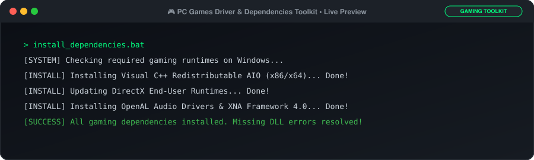

<h1 align="center">🎮 PC Games Driver & Dependencies Toolkit</h1>

  

     

---

## 📸 Project Preview

  

---

# 🚀 Overview

A curated toolkit containing all essential gaming runtime dependencies, DirectX components, OpenAL drivers, and Microsoft Visual C++ redistributable packages to resolve missing DLL errors and run PC games smoothly.

---

# 🏗️ System Architecture & Data Flow

  

 

The toolkit bundles verified silent installers for runtime frameworks, installing missing system dependencies in sequence to satisfy game executable requirements.

---

# ✨ Features

✅ **Complete VC++ Collection**: Includes Visual C++ Redistributable 2005 through 2019 (x86 and x64).\n✅ **DirectX Web Setup**: Fixes `d3dx9_43.dll`, `xinput1_3.dll`, and related DirectX errors.\n✅ **OpenAL & XNA 4.0**: Required for audio and indie games.

---

# 📦 Installation & Quickstart

Download the repository or clone it locally on Windows and run the respective installer packages directly.

---

# 👤 Author & Support
- Built with ❤️ by [@itzxsahil](https://github.com/itzxsahil)
- Star ⭐ this repository if you find it helpful!
